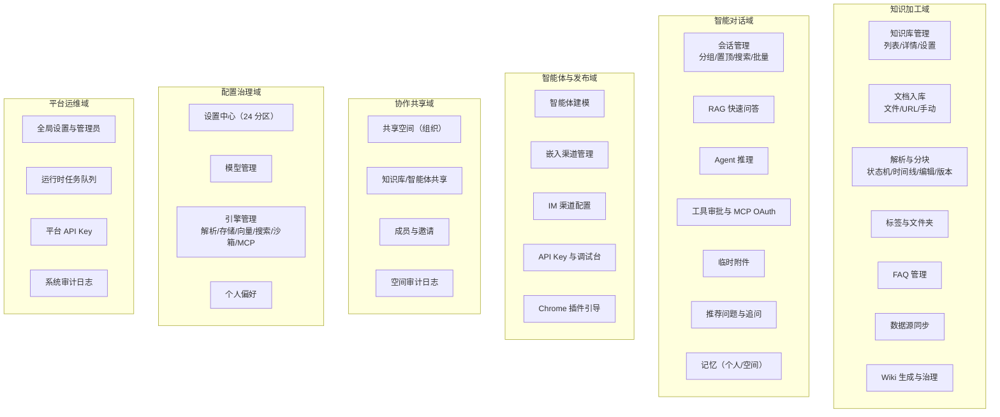
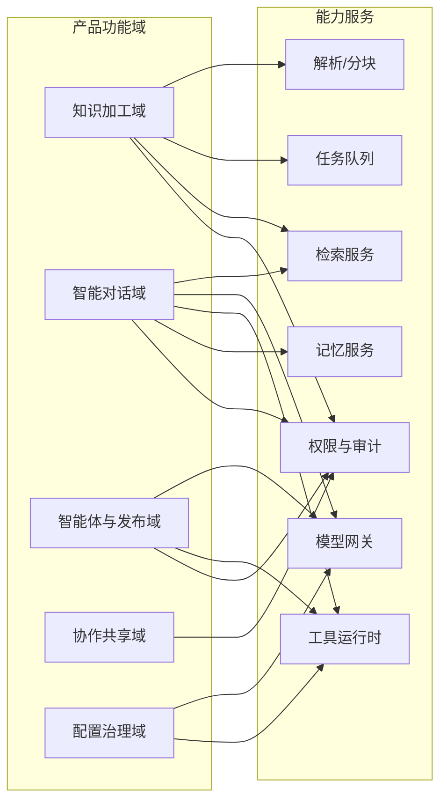
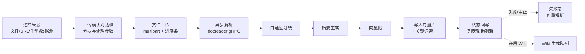
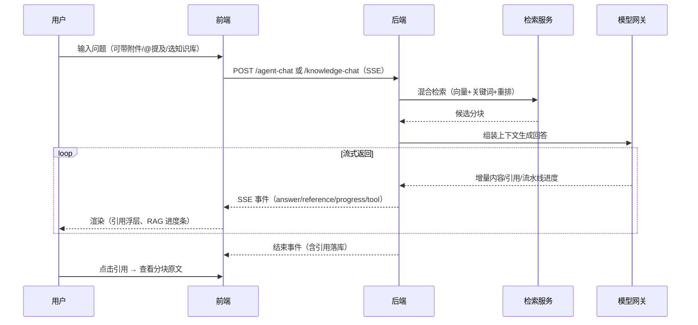
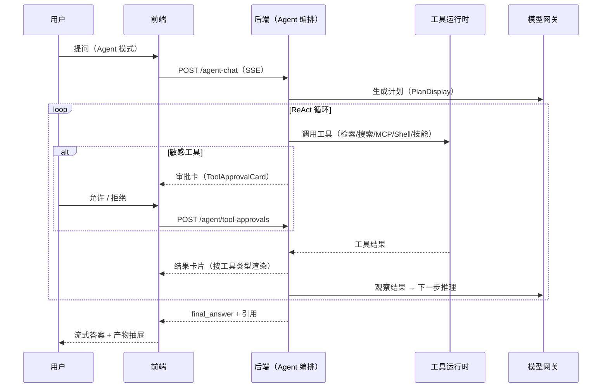
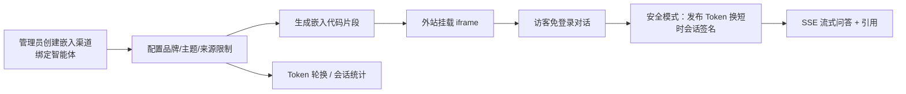
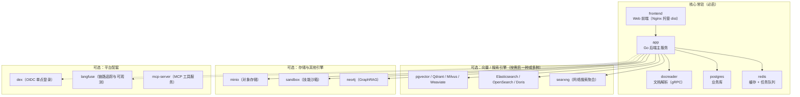

# 智枢文渊（ZhiShu）产品架构说明书

| 项 | 内容 |
|---|---|
| 产品名称 | 智枢文渊 —— 智枢数据库知识管理系统 |
| 文档版本 | v1.0（2026-10-08） |
| 基线版本 | WeKnora v0.7.2 二次开发（本仓库改造版本线 v1.0–v2.5，见 AGENT.md） |
| 配套文档 | [PRD.md](./PRD.md)（功能需求与接口清单）、README_CN.md、AGENT.md |
| 文档定位 | 用**分层架构 + 模块组合 + 数据流转**表达产品已有的设计机制，帮助新成员 / 协作方快速建立对产品的整体认知 |
| 范围声明 | 只描述 Web 前端展示与前后端交互所依赖的架构；无前端调用方或已舍弃的后端能力不纳入（见 §1.3 边界） |

---

## 1. 文档说明

### 1.1 这份文档是什么

产品架构书是产品设计的"骨架视图"：PRD 回答「每个功能是什么、怎么操作」，本说明书回答「**功能如何被组织成模块、模块如何分层协作、数据如何在层间流转、为什么这样设计**」。全部内容基于对已上线代码的走查（前端 28 个 API 模块、全部视图路由、后端路由注册表），与 [PRD.md](./PRD.md) 保持同一套事实与术语。

### 1.2 阅读路径建议

| 读者 | 建议路径 |
|---|---|
| 新加入的产品/运营 | §2 全景 → §4 功能模块 → §7 业务流程 |
| 前端/后端工程师 | §2 → §5 能力服务 → §6 数据层 → §7 流程 → §9 部署 |
| 解决方案 / 售前 | §2 → §8 设计机制 → §9 部署形态 |
| 管理层 | §2 一张图 + §1.3 边界 + §8.8 取舍策略 |

### 1.3 产品边界（与 PRD §3 一致）

- **纳入**：Web 主应用 + 嵌入 Widget 的全部界面功能，及其调用的后端接口与配套服务（解析、沙箱、队列、模型网关等）。
- **排除（已舍弃/无前端入口）**：IM 平台回调收发链路（前端仅提供渠道配置管理面）、evaluation 评估、presigned 短链、WeKnora Cloud 与 Claw Skill（前端隐藏、后端保留）、`cli/`、`mcp-server/`、`miniprogram/`、Chrome 插件本体（Web 端仅外链落地页）。
- **保留说明**：docreader 解析服务与技能沙箱服务虽为后端内部服务，但直接支撑前端功能（文档解析、技能运行），纳入描述。

---

## 2. 产品全景（一张图）

产品采用「**六层**」结构：用户与接入 → 前端应用 → 产品功能（六大域）→ 产品能力服务 → 数据与存储 → 部署基础设施。上层只通过定义好的接口使用下层，任何一层都可独立替换。

```mermaid
flowchart TB
    subgraph L0["L0 用户层"]
        direction LR
        U1["普通成员"]
        U2["内容贡献者"]
        U3["空间管理员 / Owner"]
        U4["系统管理员"]
        U5["外部访客"]
    end

    subgraph L1["L1 接入层"]
        direction LR
        A1["Web 主应用（浏览器）"]
        A2["嵌入 Widget（外站 iframe）"]
        A3["API Key 程序化接入"]
        A4["IM 渠道（仅配置管理面）"]
    end

    subgraph L2["L2 产品功能层（六大产品域）"]
        direction LR
        D1["知识加工域"]
        D2["智能对话域"]
        D3["智能体与发布域"]
        D4["协作共享域"]
        D5["配置治理域"]
        D6["平台运维域"]
    end

    subgraph L3["L3 产品能力服务层"]
        direction LR
        S1["检索服务"]
        S2["解析 / 分块服务"]
        S3["模型网关"]
        S4["工具运行时"]
        S5["任务队列"]
        S6["记忆服务"]
        S7["权限与审计"]
    end

    subgraph L4["L4 数据与存储层"]
        direction LR
        DB1["业务库（Postgres / SQLite）"]
        DB2["向量索引（多引擎）"]
        DB3["关键词索引"]
        DB4["对象存储"]
        DB5["缓存与队列（Redis）"]
        DB6["知识图谱（可选）"]
    end

    subgraph L5["L5 部署基础设施"]
        direction LR
        I1["Docker Compose 一键部署"]
        I2["Lite / Full 双形态"]
        I3["可观测（Langfuse 链路追踪）"]
    end

    L0 --> L1
    L1 --> L2
    L2 --> L3
    L3 --> L4
    L4 --> L5
```



**读图要点**

1. **用户分五类**，其中"外部访客"只能通过嵌入 Widget（免登录）与产品交互，其余四类角色在 Web 主应用内按 RBAC 分权。
2. **接入层四通道**共用同一套后端：Web 主应用走 JWT 鉴权；Widget 走 Embed Token 独立鉴权域；API Key 用于程序化集成（前端提供管理面与调试台）；IM 渠道在 Web 端只呈现"配置管理"，消息收发发生在后端。
3. **六大产品域**是产品功能的顶层组织方式（§4 展开），每个域内再分解为具体模块。
4. **能力服务层**是可复用的"产品引擎"：六大域的模块都组合调用这七类服务，而不是各自为政（§5 展开）。
5. **数据层全部可替换**：向量库、关键词索引、对象存储均支持多引擎、多实例，按知识库粒度绑定（§6 展开）。

---

## 3. 用户与接入层（L0 / L1）

### 3.1 角色 × 入口矩阵

| 角色 \ 入口 | Web 主应用 | 嵌入 Widget | API Key | IM 渠道 |
|---|---|---|---|---|
| 普通成员（Viewer） | 检索 / 问答 / 读 Wiki | — | — | — |
| 内容贡献者（Contributor） | + 传文档 / 编辑分块 / FAQ / Wiki | — | — | — |
| 空间管理员（Admin/Owner） | + 模型与引擎配置 / 成员 / 共享 / API Key | 创建与管理渠道 | 签发与调试（Owner） | 渠道绑定与启停 |
| 系统管理员 | + 平台设置 / 队列 / 平台 Key / 审计 | — | 平台级 Key | — |
| 外部访客 | — | 免登录问答 | — | 经 IM 平台对话（不在 Web 范围） |

### 3.2 双前端形态

| 形态 | 构建 | 路由 | 鉴权 | 面向对象 |
|---|---|---|---|---|
| 主应用 SPA | `index.html` + `main.ts`（Vue 3 + TDesign + Pinia） | `/platform/*` | JWT（Bearer）+ 刷新令牌 | 内部用户 |
| 嵌入 Widget | `embed.html` + `embed-main.ts`（独立构建入口） | `/embed/:channelId` | Embed Token（安全模式换取短时会话签名） | 外站访客（iframe 挂载） |

Widget 由管理员在"集成中心 / 智能体嵌入渠道"中创建渠道、生成嵌入代码后挂到外部网站；访客不经过主应用登录体系，会话按渠道隔离。

### 3.3 能力探测裁剪入口

前端启动时拉取 `GET /system/capabilities`（返回 10 个能力键），`supported=false` 的菜单/页签**整体不渲染**（如 Lite 版无"共享空间"、未启用沙箱时无"技能沙箱"设置分区）。探测失败时保持入口可见（fail-open），真实权限仍由后端每个请求校验——**部署形态决定产品长相，而界面永远不说谎**。

---

## 4. 产品功能层（L2）：六大产品域

### 4.1 功能模块地图



### 4.2 各域模块清单

> 模块的页面、操作与接口明细见 [PRD.md](./PRD.md) §5 与 §8，此处只列"模块 → 能力点 → 依赖服务"的架构关系。

#### 域一：知识加工域（产品的"进货口"）

| 模块 | 关键能力点 | 主要依赖服务 |
|---|---|---|
| 知识库管理 | 双类型库（文档 / FAQ）、置顶/收藏/复制、Wiki 徽标、共享视图、上传进度聚合 | 任务队列、权限审计 |
| 文档入库 | 四通道（本地文件/文件夹、URL、手动录入、数据源同步）、上传确认对话框、解析引擎可用性校验 | 解析/分块、任务队列 |
| 解析与分块 | 解析状态机（7 态）、Langfuse 风格解析时间线、分块可视化编辑（乐观锁）、分块版本历史与回滚、分块推荐问题 | 解析/分块、检索服务 |
| 标签与文件夹 | 多选筛选、批量打标、文件夹树（浏览/筛选双模式） | 业务库 |
| FAQ 管理 | 问答对 CRUD、批量导入导出（进度追踪）、命中测试 | 检索服务、任务队列 |
| 数据源同步 | 多类型连接器（飞书/飞书云盘/Notion/语雀/GitLab/RSS）、凭据托管、资源树下钻、同步暂停/恢复、同步日志 | 任务队列、模型网关 |
| Wiki 生成与治理 | 队列驱动自动生成、目录树、行级 diff 版本回滚、链接问题清单、知识图谱联动 | 任务队列、检索服务 |

#### 域二：智能对话域（产品的"出口"）

| 模块 | 关键能力点 | 主要依赖服务 |
|---|---|---|
| 会话管理 | 时间分组、置顶、来源筛选（我的/API/IM/嵌入）、AI 标题、批量管理、游标分页加载 | 业务库、权限审计 |
| RAG 快速问答 | 流式回答（SSE）、RAG 流水线进度、引用浮层/抽屉（区分网络与知识库来源）、断线续流 | 检索服务、模型网关 |
| Agent 推理 | ReAct 多步循环可视化、深度思考展示、多类工具结果卡片（17 个渲染器组件）、产物抽屉与下载 | 工具运行时、模型网关 |
| 工具审批与 OAuth | 敏感工具调用人工审批卡、会话内 MCP OAuth 授权卡 | 工具运行时 |
| 临时附件 | 会话级图片/文档异步解析、合并限额、预览 | 解析服务 |
| 推荐问题 | 开场推荐、答后追问、曝光/点击/忽略埋点闭环 | 模型网关 |
| 记忆 | 个人记忆（跨空间跟随）与空间记忆双层；会话内记忆步骤展示 | 记忆服务 |

#### 域三：智能体与发布域（产品的"放大器"）

| 模块 | 关键能力点 | 主要依赖服务 |
|---|---|---|
| 智能体建模 | 模型/人设/提示词模板/开场白/知识库选择策略/工具与 MCP/审批策略/发布渠道一站式编辑器、类型预设、复制 | 模型网关、工具运行时 |
| 嵌入渠道管理 | 渠道 CRUD、Token 轮换、会话统计、代码片段生成、实时预览 | 权限审计 |
| IM 渠道配置 | 10 类渠道绑定/启停、微信扫码绑定、平台回调 URL 展示（配置面） | 业务库 |
| API Key 与调试台 | 能力范围勾选（知识/自动化/协作/租户四组 18 项）、KB 范围限制、明文一次性显示、SSE 调试台、Principal 配置 | 权限审计 |
| Chrome 插件引导 | 安装落地页（外链商店） | — |

#### 域四：协作共享域（产品的"组织力"）

| 模块 | 关键能力点 | 主要依赖服务 |
|---|---|---|
| 共享空间（组织） | 组织 CRUD、邀请码/邮箱邀请、加入审批、角色 owner/admin/editor/viewer | 权限审计 |
| 知识库/智能体共享 | 按组织共享、目标空间"共享给我"视图、共享授权鉴权（本地权限不放大）、共享智能体停用 | 权限审计 |
| 成员与邀请 | 四角色成员管理（末位 Owner 保护）、多用途邀请链接（已加入计数）、个人邀请收件箱与角标轮询 | 权限审计 |
| 空间审计日志 | rbac.* 动作审计、游标分页、动作/结果/操作人过滤 | 权限审计 |

#### 域五：配置治理域（产品的"控制台"）

| 模块 | 关键能力点 | 主要依赖服务 |
|---|---|---|
| 设置中心 | 7 组 24 分区全屏弹窗、角色三重过滤、深链兜底 | 全部 |
| 模型管理 | 四类模型（对话/Embedding/Rerank/多模态+ASR）× 20+ 厂商、凭据托管、模型调试器、Ollama 本地模型下载 | 模型网关 |
| 引擎管理 | 解析引擎（含 docreader 重连）、存储后端、向量库、网络搜索供应商、技能沙箱（技能包上传/安装时间线/文件浏览）、MCP 服务（工具发现/审批策略/OAuth） | 各引擎 |
| 个人偏好 | 语言/主题/字体/字号、修改密码 | 业务库 |

#### 域六：平台运维域（系统管理员专区）

| 模块 | 关键能力点 | 主要依赖服务 |
|---|---|---|
| 全局设置与管理员 | 平台设置键值、系统管理员授予/撤销、创建用户、重置密码、默认配额 | 权限审计 |
| 运行时任务队列 | 队列运行态监控、任务明细、失败排查与重试、归档清理 | 任务队列 |
| 平台 API Key | 系统能力组 + 租户能力组全量签发 | 权限审计 |
| 系统审计日志 | 平台级审计（与空间审计同构） | 权限审计 |

---

## 5. 产品能力服务层（L3）：七类可复用引擎

六大域的模块**不直接操作数据**，而是组合调用七类能力服务——这是本产品"模块化、可替换"设计的核心。

| 能力服务 | 职责 | 关键设计 |
|---|---|---|
| ① 检索服务 | 混合检索：向量召回 + 关键词召回 → 重排 → 融合排序；支持阈值、多库扇出 | 检索阈值与策略空间级可配（KV 配置）；⌘K 语义搜索与对话检索共用同一服务 |
| ② 解析 / 分块服务 | 文档解析（gRPC 调 docreader，多解析引擎按文件类型路由）、自适应分块、摘要生成、分块实时预览调试 | 解析引擎可插拔；缺引擎时前端阻止上传并引导配置 |
| ③ 模型网关 | 统一封装 20+ 厂商的四类模型（对话/Embedding/Rerank/多模态），凭据加密托管，连通性测试，调试器 | 上层只见"模型能力"，不见厂商差异；WeKnora Cloud 厂商已随品牌裁剪隐藏 |
| ④ 工具运行时 | 内置工具（检索/Grep/数据库/图谱/Shell 等）、MCP 外部工具（含 OAuth）、技能沙箱执行、网络搜索、GraphRAG 图谱查询 | 工具统一注册与结果卡片渲染；敏感动作走人工审批 |
| ⑤ 任务队列 | 一切长任务异步化：解析、摘要、向量化、FAQ 导入、Wiki 生成、跨库移动、模型下载；分阶段独立 Worker 池、按模型并发治理 | 进度可视化三通道：XHR 上传进度 / HTTP 轮询 / SSE；运行时队列面板供管理员治理（重试/归档） |
| ⑥ 记忆服务 | 个人记忆条目（确认/拒绝/整理/导出）+ 空间级记忆开关；对话内记忆步骤可观察 | 记忆写入经用户确认，不静默收集 |
| ⑦ 权限与审计 | JWT 认证、空间角色解析（每请求）、RBAC 守卫、API Key 能力门（18+7 能力项）、审计日志（空间/平台/知识库三级）、凭据 AES 加密托管 | 前端角色仅做 UI 门控，服务端才是真实边界 |

### 5.1 模块 ↔ 服务调用关系



**读图要点**：知识加工域重度依赖「解析 + 队列」；对话域重度依赖「检索 + 模型 + 工具」；发布域复用对话域的模型与工具能力（智能体即"预设了策略的对话配置"）；权限与审计是所有域的横切底座。

---

## 6. 数据与存储层（L4）

### 6.1 数据资产分布

| 数据资产 | 承载 | 说明 |
|---|---|---|
| 业务元数据 | Postgres（Full）/ SQLite（Lite） | 空间、成员、知识库、知识、分块、会话、消息、审计、KV 配置等一切结构化状态 |
| 向量索引 | pgvector / Qdrant / Milvus / Weaviate / Elasticsearch / OpenSearch / Doris / 腾讯云 VectorDB（多选一，多实例） | 分块向量化结果；**按知识库绑定实例** |
| 关键词索引 | Elasticsearch / OpenSearch / 内置 | 混合检索的关键词腿 |
| 原始文件 | MinIO / S3 / OSS / TOS / KS3 / 本地（多实例） | 上传原件、解析产物、Embed 文件；前端经鉴权代理访问（非直链） |
| 缓存与队列 | Redis | 会话缓存 + 异步任务队列（含死信） |
| 知识图谱（可选） | GraphRAG 抽取 | 知识库级开关；对话与图谱页消费 |

### 6.2 多实例绑定机制（设计亮点）

存储后端与向量库都是**平台级注册实例、知识库级绑定使用**：管理员在设置中心登记多个实例并设默认值，每个知识库在设置弹窗中选择自己的向量库/存储实例。带来的产品能力：不同知识库可以落不同引擎（成本/性能/合规分级），迁移与替换引擎不影响其他库。

### 6.3 三类数据路径

- **入库路径（写多）**：文件 → 对象存储 → 解析 → 分块 →（摘要）→ 向量化 → 向量库 + 关键词索引 → 状态回写业务库。
- **检索路径（读多）**：问题 → 向量召回 + 关键词召回 → 重排 → 融合 → 分块引用 → 模型生成。
- **生成路径（写少）**：Wiki 页面/记忆条目/推荐问题等 AI 生成物 → 业务库（Wiki 附带版本快照）。

---

## 7. 核心业务流程与数据流转

> 每个流程配时序/流程图与读图要点。时序图中的"前端"指 Web 主应用或 Embed Widget（流程一致，仅鉴权域不同）。

### 7.1 知识入库流水线



**读图要点**

1. 上传前有**确认关**：分块参数、标签、目标文件夹在此一次性敲定；解析引擎缺失时上传入口直接被阻止并引导到设置。
2. 解析全程**异步**：前端拿到上传回执即返回列表（进度聚合面板），后续靠状态轮询 + 解析时间线（Span 树）反馈，可随时中止。
3. 解析状态机 7 态（待处理→处理中→收尾中→已完成/失败/已取消/草稿）是列表页的统一语言；失败可单条/批量重解析。
4. Wiki 开启时，入库完成后自动进入 Wiki 生成队列（面包屑"索引中"指示）。

### 7.2 RAG 问答流（SSE 时序）



**读图要点**

1. 一条 SSE 连接承载**四类事件**：答案增量、引用、流水线进度、工具调用——前端据此分区渲染，无需轮询。
2. 首字时间（TTFB）全程埋点（X-Request-ID 串联前后端日志），断线/刷新后凭 message_id **续流**，不丢答案。
3. 非 Agent 模式（knowledge-chat）与 Agent 模式（agent-chat）共用同一 SSE 通道与渲染层，仅后端编排不同。

### 7.3 Agent 推理流（ReAct 循环 + 人工审批）



**读图要点**

1. Agent 的"计划 → 工具 → 观察"每一步都对用户**可视化**，工具结果按类型渲染成专属卡片（检索结果、Shell 执行、图谱查询、Wiki 编辑等）。
2. **人工审批是架构级安全阀**：MCP 服务可按工具配置审批策略；会话中弹出审批卡，允许/拒绝实时回传，Agent 据此继续或终止。
3. MCP 远程服务首次使用时，会话内嵌 OAuth 授权卡完成三方授权，不打断对话流。
4. 技能（Skill）在独立沙箱服务中执行，安装过程本身也有 SSE 进度流与安装时间线。

### 7.4 Wiki 生成与治理流

```
开启 wiki_enabled → 文档入库完成 → Wiki 生成队列（5s 轮询 + 退避探测）
   → 自动生成互链 Markdown 页面 → 链接图谱（Graph 页可视化，双向跳转）
   → 人工修订（浏览器内编辑 + 行级 diff + 一键回滚）→ 链接问题清单治理 → 必要时重建链接
```

Wiki 是"AI 生成 + 人工治理"双轨制的典型：生成物永远带版本快照，人改过的内容可回滚，Agent 在对话中的 Wiki 编辑操作也以工具卡片回显。

### 7.5 外部发布流（以嵌入 Widget 为例）



**读图要点**：Widget 与主应用**同后端、不同鉴权域**——访客凭 Embed Token（安全模式换取 `ems_` 短时会话签名 + 访客标识），401 不触发 JWT 刷新；渠道可随时轮换 Token（旧 token 立即失效）并查看会话统计。

### 7.6 权限校验流（每个请求的固定路径）

```
请求（JWT + X-Tenant-ID 激活空间头 + X-Request-ID）
  → 认证中间件（401 → 刷新令牌自动重放；公开路径/Embed 域例外）
  → 服务端角色解析（tenant_members，随空间切换实时变化）
  → RBAC 守卫（owner > admin > contributor > viewer 资源矩阵；
     跨空间共享资源只认共享授权，本地身份不放大）
  → API KeyGate（程序化接入按能力项放行）
  → 处理 → 审计落库（空间/知识库/平台三级审计）
```

**设计原则**：前端 localStorage 中的角色仅用于渲染门控（可被篡改），服务端每请求重算才是真实边界；超管在非成员空间临时映射为 admin、永不映射 owner。

---

## 8. 关键设计机制（设计思路）

### 8.1 能力探测驱动的弹性产品形态

后端按部署实际注册的路由组生成 10 键能力清单，前端据此裁剪菜单与设置分区。由此获得三种弹性：Lite 版（无组织/注册，SQLite+本地存储）、精简部署（缺沙箱/向量库引擎时入口自动消失）、以及为二开裁剪留出的正规通道。探测失败 fail-open，保证"一次探测抖动不清空整个菜单"。

### 8.2 双鉴权域与纵深安全

| 机制 | 设计意图 |
|---|---|
| JWT + 刷新令牌（并发队列化重放） | 内部用户会话安全与体验平衡 |
| Embed Token → 短时会话签名 | 外部访客最小授权，泄露可秒级轮换 |
| 凭据 AES 加密托管 | 模型/数据源/MCP 的密钥只写不读回明文 |
| 受保护文件鉴权代理 | 对象存储不走直链，按登录态/Embed 态/共享域分别代理 |
| DOMPurify + 代码高亮隔离 | AI 生成内容渲染消毒 |
| 三级审计（空间/知识库/平台） | 敏感操作可追溯（rbac.* 等动作枚举） |

### 8.3 异步优先 + 进度可视化

一切超过秒级的操作（解析、导入、生成、下载、移动）都进任务队列，前端以三通道反馈：上传进度（XHR 事件）、状态轮询（解析 spans / 导入进度 / 移动进度）、SSE（技能安装）。失败任务在运行时队列面板中可排查、重试、归档——**用户永远知道系统在干什么、干到哪了**。

### 8.4 流式优先的对话体验

SSE 单连接承载答案/引用/进度/工具四类事件；缓冲间隔批量上屏保证渲染性能；TTFB 埋点直通后端日志；停止生成用 AbortController 即时断流；断线续流保证刷新不丢答案。

### 8.5 多空间 RBAC 与共享授权模型

空间是数据隔离基本单位；共享空间（组织）是跨空间协作单元。两条关键规则：① 角色随激活空间实时解析（切换空间即换角色视图）；② 跨空间共享资源**只认共享授权**（owner/admin/editor/viewer 四档），本地 admin 身份不能放大权限——这是共享场景下"权限不越界"的基石。

### 8.6 引擎可替换的模块化设计

模型厂商、解析引擎、向量库、关键词索引、对象存储、网络搜索供应商、沙箱均为可插拔引擎，且有统一的管理界面（列表/测试/默认实例）。产品价值：私有化部署时按已有基础设施自由组合，不被单一技术栈锁定。

### 8.7 渐进式上手设计

首访全屏引导 → 工作区初始化向导（模型连通性测试/Ollama 下载）→ 页面级分步引导（知识库/Agent 创建）→ 开场推荐问题与答后追问。冷启动链路的目标是"不读文档也能完成第一次问答"。

### 8.8 品牌裁剪与取舍策略（二开治理）

| 策略 | 做法 | 取舍逻辑 |
|---|---|---|
| 前端隐藏、后端保留 | WeKnora Cloud、Claw Skill 入口硬隐藏（`HIDDEN_SETTING_SECTIONS`），深链落"权限不足"页 | 保留回滚余地，UI 不欠账 |
| 平台统一配置（v2.9 写权限 / v2.12 可见性） | 模型、Ollama、向量库、解析引擎、存储引擎、沙箱（含技能安装）、网络搜索、MCP、检索配置**仅系统管理员可见可改**：后端九组路由 SystemAdmin-only + KV 平台键按 key 判定；前端八分区对非系统管理员整体隐藏（PLATFORM_MANAGED_SECTIONS，「看得见 = 管得了」），⌘K 检索面板同步 | 企业治理：凭据与基础设施参数集中一人，改动归因一条线；空间侧的模型/实例「选用」在知识库设置、对话、Agent 编辑器完整保留，自助建库不受影响；发布集成入口已随 v2.8 下线 |
| 业务资产治理（v2.13/v2.14） | 智能体管理权（创建/编辑/删除/复制/共享/渠道）收归空间 Admin+（对齐知识库管理模型），普通成员只读+使用；对话模型选择器仅系统管理员可见，普通用户会话由后端默认解析链（Agent 配置 → KB 摘要模型 → 首个可用对话模型）自动命中管理员配置的模型 | 智能体是空间级业务资产而非平台基础设施——治理责任落在空间管理员（多空间可扩展）；运行状态不再被普通成员改动，体验一致；模型选择对使用者透明，部署形态（单一本地模型）与界面复杂度匹配 |
| 多端会话管理（v2.15–v2.17） | auth_tokens 会话化（session_id/device_label/device_ip 三列，一次登录=一个会话，刷新轮换继承会话）；设置中心「账户」组新增登录设备面板：本人活跃会话列表（本机高亮）+ 逐条踢下线（自踢保护） | 多端并存（电脑+手机工作流）是知识库产品的真实形态，治理目标是**可见可控**而非盲目互踢；每请求撤销校验现成，踢除下一请求即生效；被踢设备复用现有 401→登录链路 |
| 账号管理（v2.19–v2.21） | 设置中心「系统管理」组新增账号管理分区：平台账号目录（搜索/过滤/分页）、新建、资料编辑（唯一性校验）、禁用/启用（禁用 = is_active=false + RevokeTokensByUserID，登录路径已有 IsActive 检查，禁用下一请求即全端 401）、跨空间角色调整/移出（转发 TenantMemberService，ErrLastOwner 保护与 rbac.* 审计继承，另补 system.membership_* 平台审计）、任意账号多端会话查看/踢除/全部下线；零数据库迁移（复用 is_active 与 auth_tokens 会话列）；窄接口 SystemUserAdminService 挂同一 userService，dig 形状不变 | 平台级账号治理是系统管理员职责的自然延伸（个人会话面板 v2.16 的管理员视角）；删除账号后置——users 已有软删除基础，但知识库/会话/记忆归属数据的级联决策值得单独方案；自我保护（target==caller 一律 400 + 前端隐藏）杜绝管理员自锁 |
| 能力开关正规化 | 组织/智能体/集成/五个设置分区走 capabilities | 部署差异由机制而非硬编码表达 |
| 旧 URL 兼容 | `/platform/system/*`、`/platform/integrations` 全部重定向到设置中心对应分区 | 书签不失效，页面不重复 |
| 显示层品牌化 | 名称/Logo/人设/环境变量前缀/镜像标识系统化替换 | 逐版本记录于 AGENT.md，可审计可还原 |

---

## 9. 部署形态与组件拓扑

### 9.1 组件拓扑



**读图要点**：核心五件套即可跑通"建库—入库—问答"最小闭环；其余全部按 profile 选装（`milvus` / `doris` / `langfuse` 等独立 profile），缺装时对应能力入口由能力探测自动隐藏。docreader 与 app 之间是 gRPC（支持 TLS）；技能沙箱为独立服务（可配置启停模式）。

### 9.2 Lite 与 Full 双形态对比

| 维度 | Lite（单机轻量） | Full（完整部署） |
|---|---|---|
| 业务库 | SQLite（DB_PATH） | Postgres |
| 对象存储 | 本地目录 | MinIO / S3 / OSS / TOS / KS3 |
| 共享空间 | 无（organizations 能力强制关闭、注册可禁用） | 支持 |
| 认证 | 本地账密 + auto-setup 自动建号 | + OIDC（dex 或外部 IdP） |
| 模型 | 常配 Ollama 本地模型 | 20+ 云厂商自由组合 |
| 面向场景 | 个人/桌面端（Wails 复用同一前端） | 团队/企业私有化 |

### 9.3 标识与一键运维

镜像 `zhishu/*`、容器 `ZhiShu-*`、Compose 项目名 `zhishu`、环境变量前缀 `ZHISHU_`、数据库名 `ZhiShu`；Windows 侧提供 `start_zhishu.bat` / `stop_zhishu.bat` 一键启停（启动后自动跟踪日志）。

---

## 10. 附录

### 10.1 产品域 ↔ 页面 ↔ 接口速查

| 产品域 | 主页面/入口 | 接口分组（PRD §8） |
|---|---|---|
| 知识加工域 | `/platform/knowledge-bases(/:kbId)` | 8.3 知识库与文档、8.4 FAQ、8.5 数据源、8.6 Wiki |
| 智能对话域 | `/platform/creatChat`、`/platform/chat/:id` | 8.7 对话与会话 |
| 智能体与发布域 | `/platform/agents`、设置中心·发布集成 | 8.8 智能体/MCP/技能、8.9 模型、8.12 发布集成 |
| 协作共享域 | `/platform/organizations` | 8.11 共享空间 |
| 配置治理域 | `/platform/settings` | 8.10 空间与成员、8.13 系统管理（部分） |
| 平台运维域 | 设置中心·系统管理组 | 8.13 系统管理与平台治理 |
| 外部发布 | `/embed/:channelId` | 8.14 Embed 前台、8.15 受保护文件代理 |

### 10.2 配套文档

- [PRD.md](./PRD.md)：功能需求、用户旅程、完整接口清单（含已不使用的遗留接口盘点 §8.16）
- [AGENT.md](./AGENT.md)：二开规范与逐版本改造记录
- [README_CN.md](./README_CN.md)：上游能力总览与快速开始
